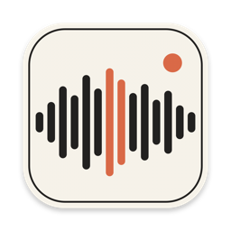
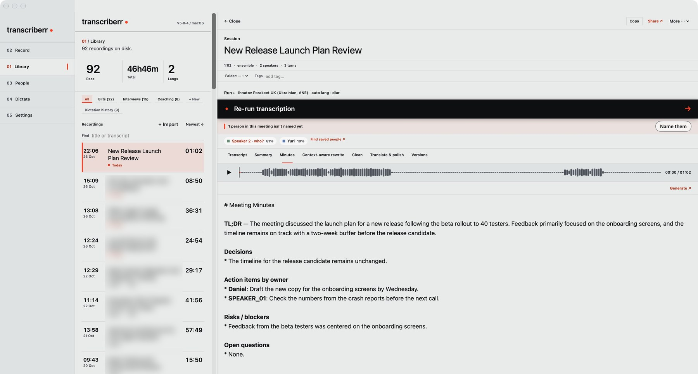
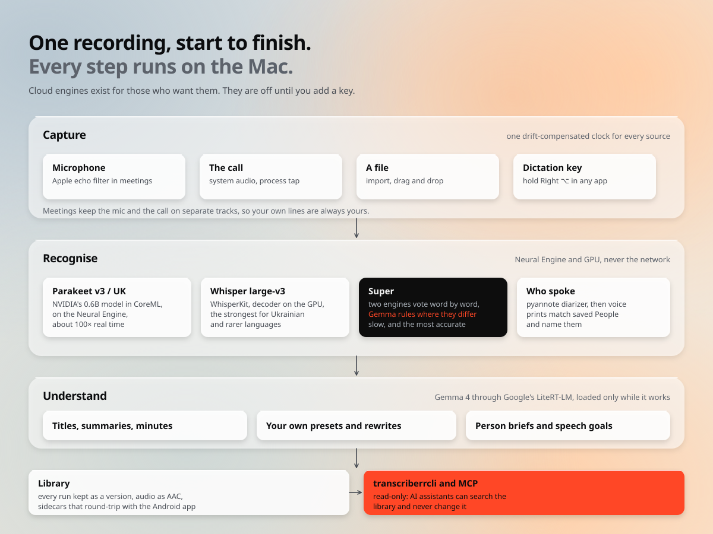
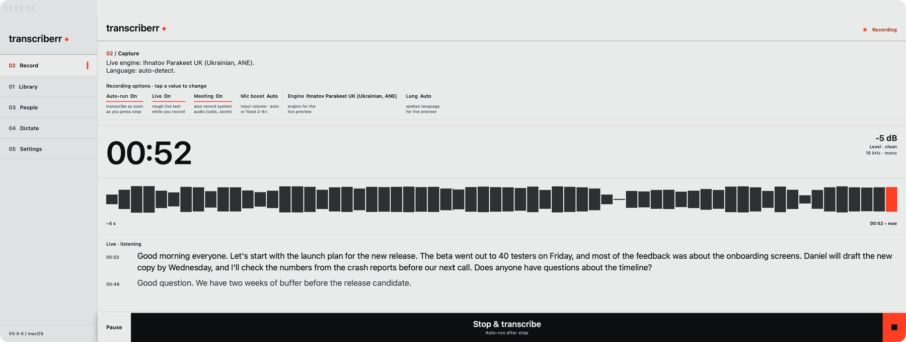
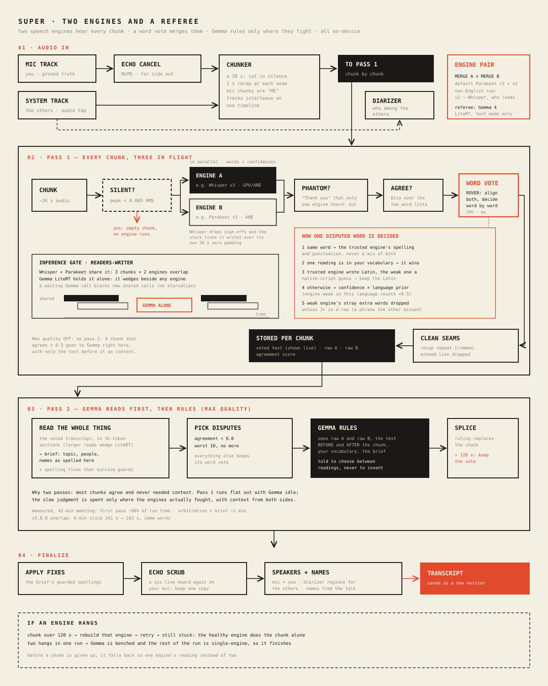
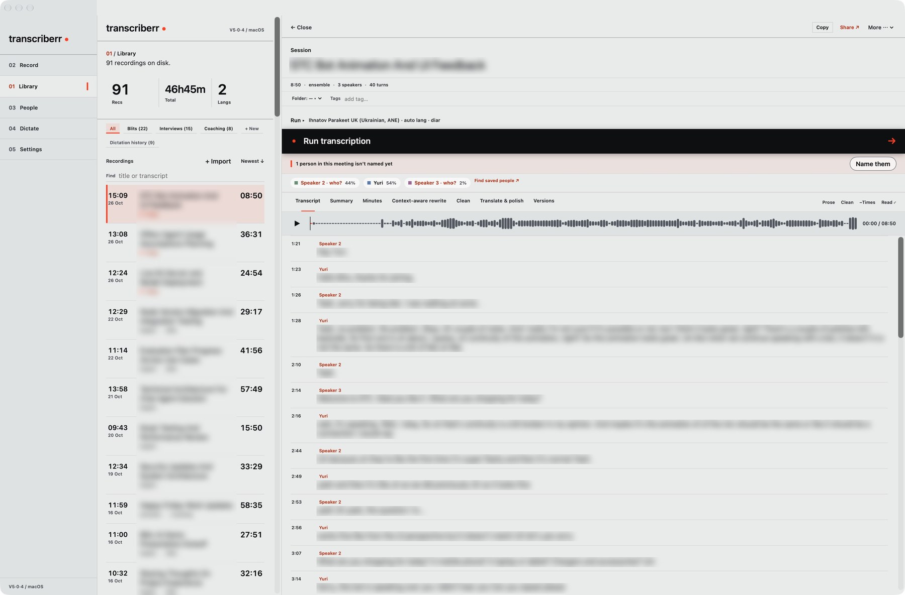
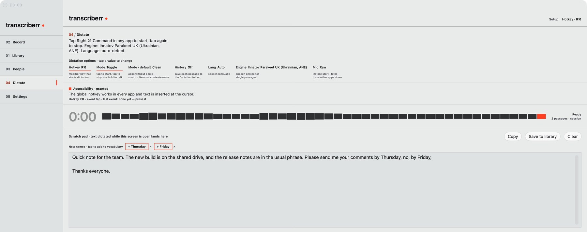
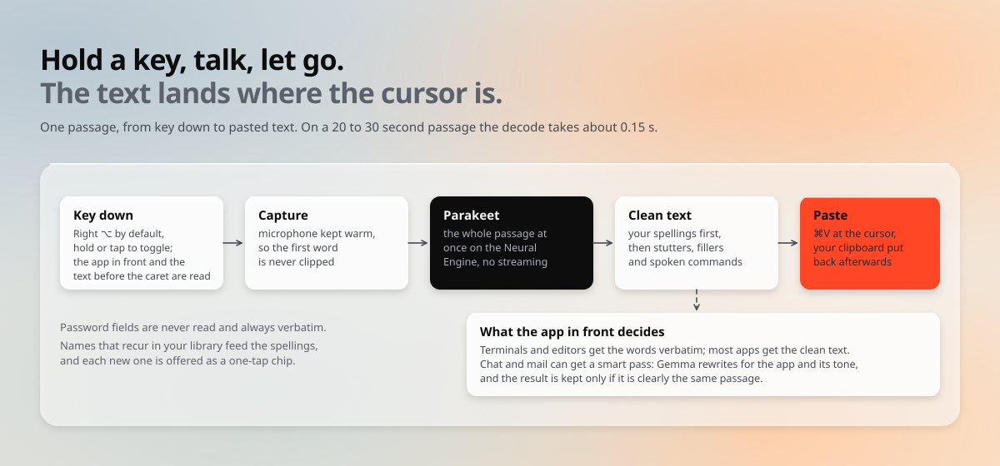
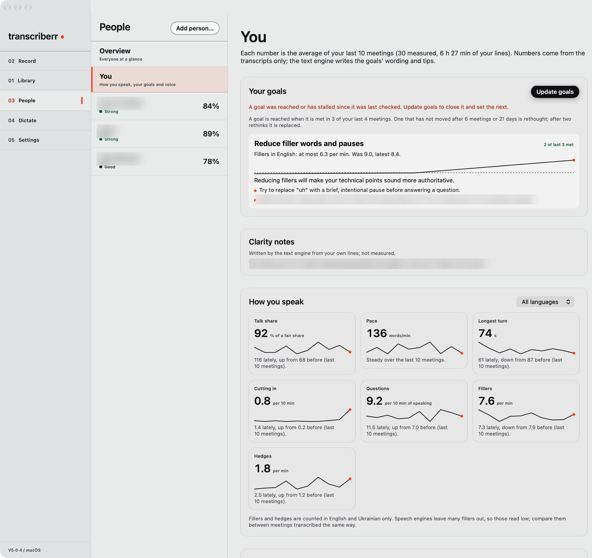
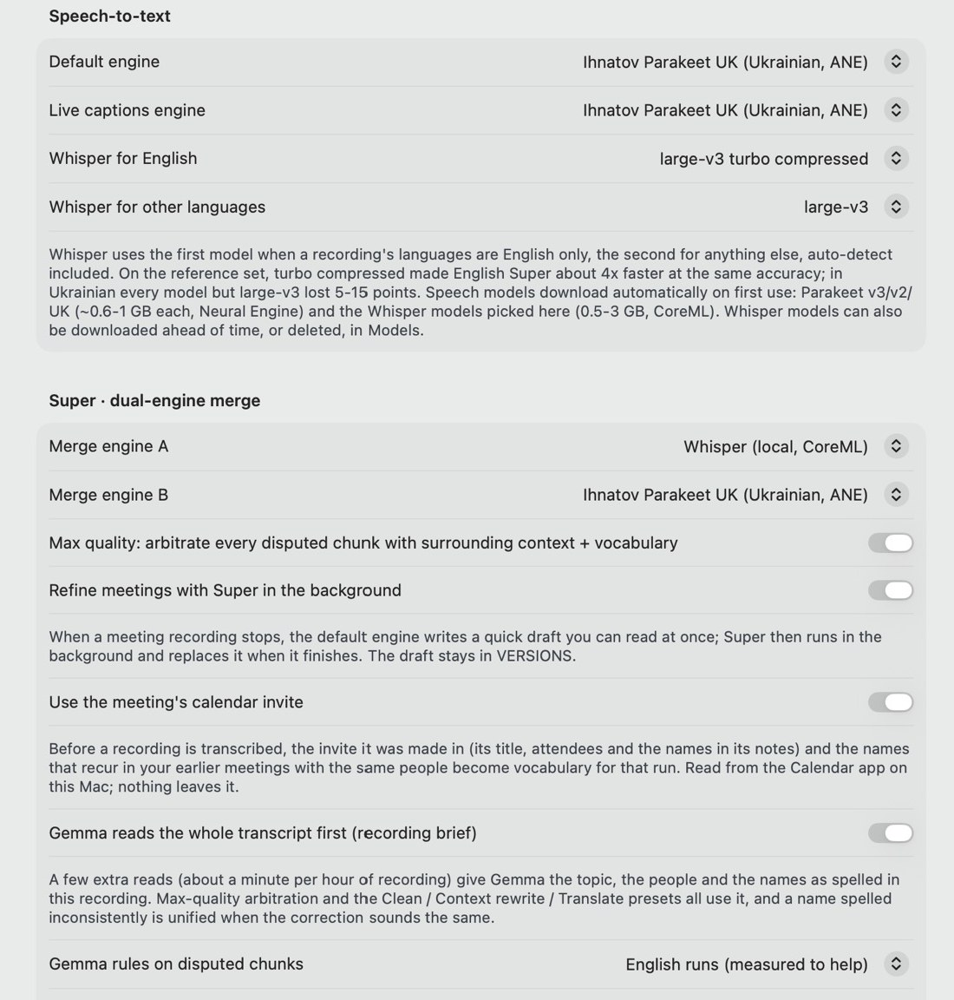

#  Transcriberr

Transcriberr is a transcription studio for the Mac that never sends your audio anywhere. It records meetings with the call and your microphone on separate tracks, transcribes them with speech models running on the Neural Engine and the GPU, works out who said what, learns the voices of the people you talk to, writes the minutes with a local language model, and lets you dictate into any app by holding a key. The library it builds can be read by AI assistants through a read-only MCP server, so an hour-long meeting from last Tuesday is one question away.

I built it because I wanted the quality of the cloud services without handing them every conversation I have at work. It runs on Apple Silicon, needs macOS 26, and is free for personal and other noncommercial use.

**[Download the latest release](https://github.com/Ihnatov-yuri/Macos-Transcriber/releases/latest)** · [Build notes: what I learned making it](https://ihnatov.nl/transcriber/macos/) · [Android companion](https://github.com/Ihnatov-yuri)



<sub>A one-minute test meeting, recorded on the Mac and summarised by Gemma, with nothing sent over the network. Titles of the other recordings in my library are blurred.</sub>

## How it works

A recording passes through four stages, and every one of them runs on the Mac. Audio comes in from the microphone, from the call (tapped digitally from the system's audio, so Zoom, Teams and Meet all work without a plug-in), from a file you import, or from the dictation key. Speech engines turn it into words with timings and confidence. A diarizer separates the voices, and voice prints you have saved turn "Speaker 2" into a name. Then Gemma, Google's open model, reads the transcript to give it a title, write a summary or minutes, run your own prompts, and keep a short brief on each person you meet.



Cloud engines (OpenAI, Anthropic, Gemini) are in the code for anyone who wants them. They stay off until you add a key, and a person's page says so when a brief would send their lines to one.

## Recording and meetings

The Record screen shows the clock, the level and a rough live caption while you talk, so you can see that it is hearing you. When you stop, the default engine writes a draft you can read straight away. With background refinement on, Super then runs on the meeting and replaces the draft when it finishes, and the draft stays among the versions.



Meeting mode records the microphone and the system audio on one drift-compensated clock and keeps both tracks. With the call on its own track, every line from your microphone is yours, and the diarizer only has to untangle the other people. When the call plays through the speakers, Apple's own echo filter (the one FaceTime uses) runs on the microphone while the meeting records, and an offline echo canceller and a sentence-level scrub catch what gets through. If the meeting is in your calendar, the invite's attendees become vocabulary for that run and help name the people in it.

## Speech engines

| Engine | Model | Runs on | Good at |
|---|---|---|---|
| Parakeet v3 | NVIDIA parakeet-tdt-0.6b-v3, CoreML | Neural Engine, about 100× real time | English and the major European languages, long files |
| Parakeet UK | Parakeet v3 fine-tuned for Ukrainian ([on Hugging Face](https://huggingface.co/ihnatov-yuri/parakeet-tdt-0.6b-v3-uk)) | Neural Engine | Ukrainian, and English sentences inside Ukrainian speech |
| Whisper | OpenAI whisper-large-v3 through WhisperKit | GPU and Neural Engine | Ukrainian and rarer languages; turbo models for English |
| Super | Two of the above, merged word by word, with Gemma as referee | Mixed | The most accurate transcript, at the cost of time |

Models download on first use into `~/Library/Application Support/Transcriberr/models`, which macOS does not purge and Time Machine skips. Parakeet UK updates itself from Hugging Face, and every file is checked against its published fingerprint before it is used.

Super is the mode I use for anything that matters. Both engines transcribe every chunk at once, a ROVER vote merges their words using each engine's confidence and a per-language prior, and only the chunks where they disagree go to Gemma, which sees both readings, the text on either side and your vocabulary, and is told to choose between them and never to invent. On a 42-minute meeting the arbitration takes about a minute. The full walk-through, stage by stage, is in **[docs/super-mode.md](docs/super-mode.md)**.

[](docs/super-mode.md)

## Transcripts, versions and presets

Each speaker line has its timestamp, its speaker and a colour, and clicking a line plays the audio from there. A row above the transcript shows everyone in the recording with how much of it they talked; unnamed speakers can be named one by one, and a name you give carries into every saved version. The header switches between clean reading text, with the ums and stutters taken out, and exactly what was said.



Every engine run is kept as a version, so two engines can be compared side by side and any version restored. Summary, Minutes, Clean, Translate & polish and Context-aware rewrite are presets: prompts you can edit, duplicate, reorder or add to, each with a history of earlier prompts and outputs. A deterministic pass removes stutters, phrase echoes and hesitation fillers before Gemma sees the text. In an early test it took 371 fillers out of one meeting before the model saw a word of it. Your vocabulary (names, products, the spellings you care about, global or per language) is fed into the speech engines and every preset, and Transcriberr harvests recurring names from your library and offers them as additions.

Recordings live in folders and tags, audio is stored as AAC, and sidecar files (`.txt`, `.srt`, `.json`, `.speakers.json`) round-trip with the Android app. Share › Export to a folder writes everything about one recording, every version and output included, with a checksummed manifest.

## Dictation

Hold Right ⌥ in any app, talk, and let go: the text lands at the cursor. Parakeet decodes the whole passage at once on the Neural Engine, so there is no streaming lag and the model sees the full sentence, and a 20-second passage comes back in well under half a second. Tap mode keeps the microphone open and writes a paragraph at every pause.



Before anything is pasted the text goes through the same cleanup as the transcripts: your spellings first, then stutters and fillers, then spoken commands such as "new paragraph", "comma" or "scratch that" (also in Dutch, German and Ukrainian). The app in front decides how far to go. Terminals and code editors get the words verbatim, most apps get the clean text, and chat and mail can get a smart pass in which Gemma rewrites the passage for that app and its tone, guarded so that the result is used only when it is clearly the same passage. Password fields are never read.



Dictation needs the Microphone, Accessibility and Input Monitoring permissions once; the Dictate screen walks through them and shows the last key event it saw, so a hotkey that does nothing is easy to diagnose. There are Shortcuts actions, a menu bar item, a floating status strip, optional history saved as ordinary recordings, and a URL scheme (`transcriberr://dictate/start`, `/stop`, `/toggle`, `/cancel`) for Raycast or a Stream Deck.

## People

Transcriberr can learn the voices of the people you talk to. Name a speaker in one recording and choose to remember their voice; later recordings name them on their own, on calls and in the room. Each person gets a page with every recording they speak in, how sure the app is of recognising them and why, every voice sample with where it came from, and a brief written by Gemma: what they said in their last meeting, what they committed to and the questions they left open, each item linked to the moment it was said.

A voice is only added to someone when it clearly sounds like them, measured against everyone else saved, you included. Find people goes through the whole library once and names the people it is sure of, then asks about the rest.



The You page measures how you speak in meetings, per language: talk share against a fair share, pace, longest turn, how often you cut in, questions, fillers and hedges. Set goals picks up to two things to work on and words them with tips from your own lines, while the numbers alone decide whether a goal is reached. The voices stay on the Mac, outside Time Machine, and deleting a person removes their voice.

## Your library as a knowledge base

`transcriberrcli` ships next to the app. Its `kb` commands (`list`, `search`, `get`, `outputs`, `folders`, `tags`, `stats`) print the library as versioned JSON, and `transcriberrcli mcp` runs an MCP server with the same six tools (`kb_list`, `kb_search`, `kb_get_transcript`, `kb_get_outputs`, `kb_folders_tags`, `kb_stats`). Both open the store with saving disabled, so they can read while the app is running and can never change or migrate anything. Transcripts come back clean or verbatim, as you ask.

An MCP client starts it as a stdio server, with the Release build's binary as the command and `mcp` as its argument:

```json
{
  "mcpServers": {
    "transcriberr": {
      "command": "/path/to/Transcriberr/.build/xcode/Build/Products/Release/transcriberrcli",
      "args": ["mcp"]
    }
  }
}
```

Settings › AI assistants has a switch for this. With it off, a connected assistant sees no tools and is refused at its next request. The same section shows when an assistant last read the library.

## Privacy

Everything above runs locally: recording, both speech engines, diarization, voice prints, Gemma, search and the MCP server. Audio, transcripts, voices and briefs stay in `~/Library/Application Support/Transcriberr` and your Recordings folder, with transcript backups in `~/Documents/Transcriberr Backups`. The app talks to the network for four things only: downloading a model the first time you need it, checking GitHub for a new version (it asks once, on first launch, and the request is the same from every Mac), asking Hugging Face once a day whether Parakeet UK has a newer release while those checks are on, and a cloud engine if you add a key for one.

## Settings

<p align="center"></p>

Settings hold the global defaults: the default and live-caption engines, which Whisper model to use for English and for other languages, the two engines Super merges, whether meetings are refined in the background, the calendar invite, your name for the microphone track, the dictation rules per app, the presets and the vocabulary. Each recording can override the engine, languages, diarization, expected speakers and translation in its own Run sheet.

## Install

Each [release](https://github.com/Ihnatov-yuri/Macos-Transcriber/releases/latest) is a zip with the signed app inside, which goes into Applications. From 3.14.2 on, the app installs its own updates after checking their signature. It needs an Apple Silicon Mac and macOS 26. The speech models download themselves on first use (Parakeet about 0.6 GB, Whisper 0.5 to 3 GB); Gemma's `.litertlm` bundles are downloaded from Settings › Models.

## Build from source

You need Xcode 26 and [XcodeGen](https://github.com/yonaskolb/XcodeGen). `./setup.sh` installs XcodeGen if it is missing, generates the project, resolves the packages and patches them, and opens Xcode.

From the command line the build always uses the `Transcriberr` scheme and the repo's own derived-data folder. Xcode's default DerivedData trips over a stray file in the LiteRT-LM package, and the scripts expect the products under `.build/xcode`.

```bash
xcodegen generate
xcodebuild -project Transcriberr.xcodeproj -scheme Transcriberr \
    -configuration Release -destination "platform=macOS" \
    -derivedDataPath .build/xcode build
scripts/package.sh
open .build/xcode/Build/Products/Release/Transcriberr.app
```

`scripts/package.sh` has to run after every Release build. The app embeds Google's LiteRT-LM dylib, signed by Google's team, and dyld refuses to load it into an ad-hoc signed app until the script re-signs it. The script also signs with an identifier-based requirement and hardened runtime, so the microphone and Accessibility grants survive updates.

FluidAudio and LiteRT-LM both ship a `NemoTextProcessing` framework with its own `include/module.modulemap`, and Xcode refuses to build with two of them. The patch has to be applied again after every package resolve (a fresh clone, a version bump, Reset Package Caches):

```bash
scripts/patch-artifacts.sh .build/xcode/SourcePackages
```

Shipping a version, with notes, signing and the GitHub release, is described in [docs/RELEASING.md](docs/RELEASING.md).

## Tests

```bash
xcodebuild test -project Transcriberr.xcodeproj -scheme Transcriberr -destination "platform=macOS" \
    -derivedDataPath ~/Library/Caches/transcriberr-test-dd -clonedSourcePackagesDirPath .build/xcode/SourcePackages
```

The unit tests cover the logic at the core: destutter, echo scrub and trim, the ROVER merge, chunk windowing, the NLMS canceller against synthetic ground truth, the dictation text stages, the voice gate, the repository, the compressor, the KB layer and the player. Every release passes the suite first. The test derived data lives outside `~/Documents` on purpose: launchd starts the test host, which would block on the "access your Documents folder" prompt with nobody there to answer it.

Unit tests say the logic holds. Every serious defect in this project was found on real recordings, so two scripts check the whole pipeline against them. `scripts/realworld-test.sh <recording.m4a> <start-sec> <duration-sec> <Language>` cuts a slice from a real recording with its mic and system tracks, runs it headlessly through the full pipeline and counts the defects this project has been bitten by (subtitle sign-offs, seam repeats, word loops, script drift) next to the stored transcript. `scripts/eval-set.sh <label>` scores a build against a reference set of five-minute meeting slices, two English and two Ukrainian, kept outside the repo in `~/Documents/Transcriberr-eval`; two runs of the same build agree to about 0.2 WER points. Recordings are private and never belong in the repo.

## Built on

[FluidAudio](https://github.com/FluidInference/FluidAudio) for Parakeet and the diarizer in CoreML, [WhisperKit](https://github.com/argmaxinc/WhisperKit) for Whisper, and Google's [LiteRT-LM](https://github.com/google-ai-edge/LiteRT-LM) for Gemma. The longer story of building it, including the model that turned a business meeting into a conversation about music production, is in the [build notes](https://ihnatov.nl/transcriber/macos/).

Made by **Yuri Ihnatov**, [ihnatov.nl](https://ihnatov.nl) · [github.com/Ihnatov-yuri](https://github.com/Ihnatov-yuri)

## License

**PolyForm Noncommercial 1.0.0**: free for personal, hobby, research and other noncommercial use. Commercial use needs a separate license; write to [atoman@gmail.com](mailto:atoman@gmail.com). The [Android app](https://github.com/Ihnatov-yuri) remains Apache-2.0. The optional High accuracy voice model is CC BY-NC-SA 4.0.
